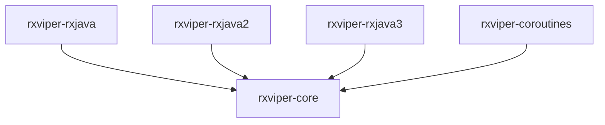

# RxViper

This is a micro framework with a small, extensible API which provides basic
abstractions for building your apps using VIPER architecture.

> I copy these classes into all apps I make. I'm tired of doing it. Now it's a library. ©

Now written in Kotlin, RxViper works in Android apps and ordinary JVM applications.
VIPER stands for **View, Interactor, Presenter, Entity, Router**.
Views display data and forward user input; presenters coordinate
presentation; interactors implement use cases; entities represent domain data;
routers own navigation. Your application supplies storage, networking and dependency
injection.

This is the **2.0.0-SNAPSHOT** rewrite. It intentionally changes the 1.x API and
artifact layout. These snapshot coordinates are for local builds; this change does
not publish a release to Maven Central or the Gradle Plugin Portal.

## Dedicated slides and video from my talk @ GDG Minsk 2016

[SpeakerDeck](https://speakerdeck.com/dmitriyzaitsev/viper-sexy-architecting-or-mvp-on-steroids) or [SlideShare](http://www.slideshare.net/DmitriyZaitsev2/sexy-architecting-viper-mvp-on-steroids)

[](https://www.youtube.com/watch?v=pSSN_dnadKU)

## Modules

| Artifact | Public API | Runtime dependencies beyond Kotlin |
| --- | --- | --- |
| `rxviper-core` | `Presenter`, `ViperPresenter`, `ViewCallbacks`, `Router`, `Mapper` | None |
| `rxviper-rxjava` | `rxjava.Interactor` returning `Observable` / `Subscription` | Core, RxJava 1.3.8 |
| `rxviper-rxjava2` | `rxjava2.Interactor` returning `Flowable` / `Disposable` | Core, RxJava 2.2.21 |
| `rxviper-rxjava3` | `rxjava3.Interactor` returning `Flowable` / `Disposable` | Core, RxJava 3.1.12 |
| `rxviper-coroutines` | `coroutines.SuspendInteractor`, `coroutines.FlowInteractor` | Core, coroutines 1.11.0 |
| `rxviper-gradle-plugin` | Kotlin scaffolding generator | Gradle, Kotlin; no runtime backend |

Every backend exposes core transitively. Pick the backend you use, or use core
alone. Backends do not depend on each other and their classes live in separate
packages, so an application can migrate between them incrementally. No Android,
RxAndroid, reflection library, or coroutine dependency is forced into core.



## Build and use locally

Use JDK 17 or newer (validated with JDK 21). Runtime jars target JVM 8 bytecode;
the Gradle plugin targets JVM 17. Sources and published metadata use Kotlin 2.4.21.
An Android SDK is required only for the opt-in sample.

```sh
./gradlew check assemble
./gradlew publishAllPublicationsToBuildRepository
```

This writes a Maven repository to `build/repository`, including the Gradle plugin
marker. To use the snapshot in another local project, add that directory to its
repositories and choose a module:

```kotlin
repositories {
    maven { url = uri("/path/to/RxViper/build/repository") }
    mavenCentral()
}
dependencies {
    implementation("com.dzaitsev.rxviper:rxviper-coroutines:2.0.0-SNAPSHOT")
    // Or rxviper-core, rxviper-rxjava, rxviper-rxjava2, rxviper-rxjava3.
}
```

The toolchain is pinned in the [version catalog](gradle/libs.versions.toml) and
[checksummed wrapper](gradle/wrapper/gradle-wrapper.properties): Gradle 9.9.1,
Kotlin 2.4.21 and Android Gradle Plugin 9.5.1. These are stable releases verified
on 2026-11-17. Kotlin's documented fully tested Gradle range ends at 9.7.0;
the tests, generator compilation, publication and Android build validate this
project's use of 9.9.1. RxJava 1 and 2 intentionally use their final releases.

## Presenters and lifecycle

Core stays the same whichever async backend you choose:

```kotlin
import com.dzaitsev.rxviper.Presenter
import com.dzaitsev.rxviper.ViewCallbacks

interface ProfileView : ViewCallbacks {
    fun showName(name: String)
}

class ProfilePresenter : Presenter<ProfileView>(ProfileView::class.java) {
    fun display(name: String) = view.showName(name)
    override fun onTakeView(view: ProfileView) {
        this.view.showName("Welcome")
    }
}

val presenter = ProfilePresenter()
// presenter.takeView(activity) when visible; presenter.dropView(activity) when hidden.
```

`view` is a stable proxy with a weak reference to the attached view. Calls while
detached are ignored. Keep a strong reference to actual views and routers in the
application. Callback contracts must be interfaces with only `Unit`/`void` methods;
getters, return values and suspend callbacks are rejected. Initial targets may be
passed to constructors without calling overridable hooks during construction.

Lifecycle methods and callbacks belong on one UI thread. Repeated takes are ignored,
replacement drops the old target first, and a stale drop cannot detach a newer
view. `onTakeView` runs after attaching; `onDropView` runs before clearing the target.
Override `onDropView` to cancel view-bound work. Detaching a view alone does not
cancel interactors. `ViperPresenter<V, R>` adds the same lifecycle for `router`:

```kotlin
interface ProfileRouter : com.dzaitsev.rxviper.Router {
    fun openSettings()
}
class NavigationPresenter : com.dzaitsev.rxviper.ViperPresenter<ProfileView, ProfileRouter>(
    ProfileView::class.java, ProfileRouter::class.java,
) {
    fun settingsClicked() = router.openSettings()
}
```

Full [core lifecycle details](rxviper-core/README.md).

## Coroutines

A suspend interactor represents a single result. Its dispatcher controls the work;
the caller owns cancellation and the context in which the result is delivered.
Use `Unit` for a use case without a request.

```kotlin
import com.dzaitsev.rxviper.coroutines.SuspendInteractor
import kotlinx.coroutines.CoroutineDispatcher

class LoadName(dispatcher: CoroutineDispatcher) : SuspendInteractor<Long, String>(dispatcher) {
    override suspend fun run(request: Long): String = "User $request"
}

// Inside an existing UI coroutine: view.showName(loadName(userId))
// Or: val job = loadName.execute(uiScope, userId, onSuccess = { ... }, onError = { ... })
// Cancel job on view detach; cancel the owning scope when its lifecycle ends.
```

For streaming data, extend `FlowInteractor<Request, Response>` and implement
`createFlow(request): Flow<Response>`. Calling `interactor(request)` returns a cold
Flow. Source creation and upstream work run in the injected dispatcher; collection
runs in the caller's context. Native Flow operators provide composition and
backpressure. `execute(scope, request, onNext, onError, onComplete)` returns a `Job`.

Neither interactor owns a global or hidden scope. Cancellation propagates to the
work and is never reported to `onError`; cancelled streams do not call `onComplete`.
Errors from downstream callbacks propagate to the owning scope. `invoke` propagates
source errors directly; the `execute` convenience functions route source errors to
the explicit error callback. On Android, use a Main scope and add
`kotlinx-coroutines-android` in the application; core has no Android dependency.

## RxJava 1, 2 and 3

RxJava 2 and 3 use Flowable for backpressure. The API shape is the same; only imports
and artifact names differ. RxJava 1 uses Observable and `createObservable`.

```kotlin
import com.dzaitsev.rxviper.rxjava3.Interactor
import io.reactivex.rxjava3.core.Flowable
import io.reactivex.rxjava3.core.Scheduler

class LoadName(subscribeOn: Scheduler, observeOn: Scheduler) :
    Interactor<Long, String>(subscribeOn, observeOn) {
    override fun createFlowable(request: Long): Flowable<String> =
        Flowable.fromCallable { "User $request" }
}

// val handle = loadName.execute(userId, onNext = { ... }, onError = { ... })
// handle.dispose() cancels this execution; loadName.clear() cancels all managed work.
```

Both source construction and subscription are deferred onto the subscription
scheduler. Values and terminal events use the observation scheduler. Supply a main
thread observation scheduler for UI work; the library does not choose one.
Use `Schedulers.io()` for blocking I/O and a computation scheduler for CPU work.

`execute` returns a native handle for one execution and requires explicit error
handling. `clear()` cancels active executions and permits reuse. RxJava 1
`unsubscribe()` and RxJava 2/3 `dispose()` are terminal: later `execute` calls fail.
Completed subscriptions are removed from the managed container. For native
operators, custom subscribers or explicit request-based backpressure, call
`interactor(request)` and subscribe directly; those subscriptions belong to the
caller and are independent of `clear()` and terminal disposal.

## Mapping and scaffolding

`Mapper<From, To>` is a functional interface independent of Rx:
`val mapper = Mapper<Int, String> { it.toString() }`. Use `mapper(value)`,
`mapper.mapAll(values)`, or pass `mapper::map` to Rx and Flow operators.

The optional [Gradle plugin](rxviper-gradle-plugin/README.md) generates Kotlin view,
presenter, router and interactor starter files for any backend. The plugin README
includes configuration and migration from the old DSL. Generated code is compiled
against every backend in tests.

## Android sample

The [cheese browser sample](sample/README.md) uses the same core with coroutine
interactors, native Android widgets and explicit dependency construction. It
illustrates list/details navigation, main-thread callbacks, cancellation on view
detach and scope cleanup on destruction.

```sh
./gradlew -PandroidSample=true :sample:assembleDebug :sample:testDebugUnitTest :sample:lintDebug
```

## Migration from 1.x

See [MIGRATION.md](MIGRATION.md) for artifact, package, lifecycle, mapper and generator
changes. This rewrite is source and binary incompatible with 1.x.

## License

Copyright 2016–2026 Dmytro Zaitsev. Licensed under the
[Apache License, Version 2.0](LICENSE.txt).
